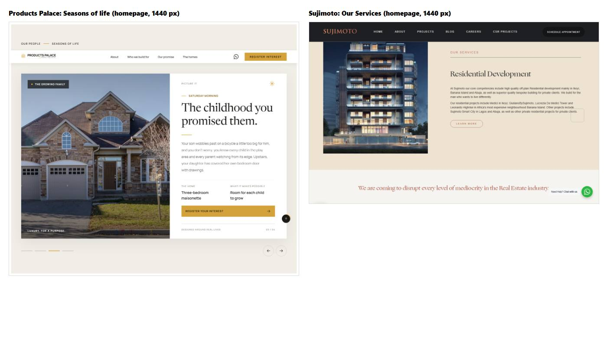
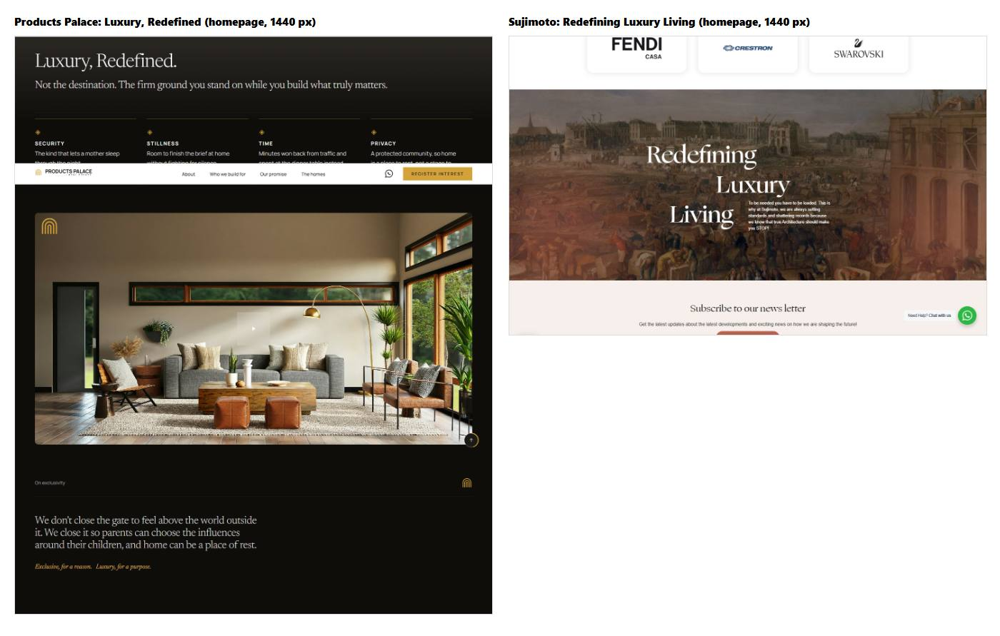
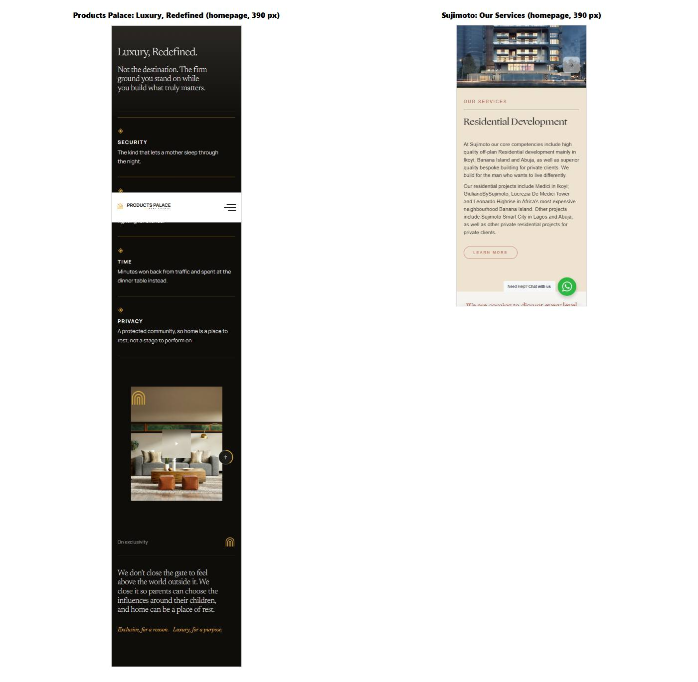
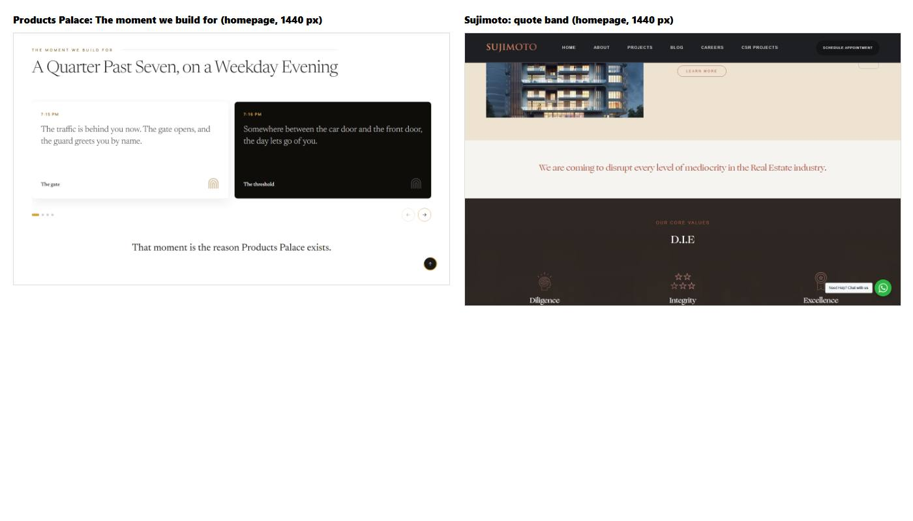
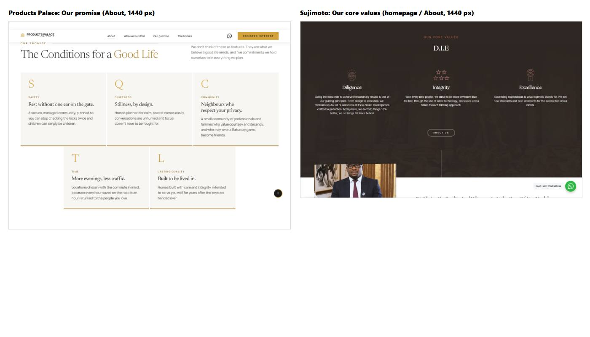
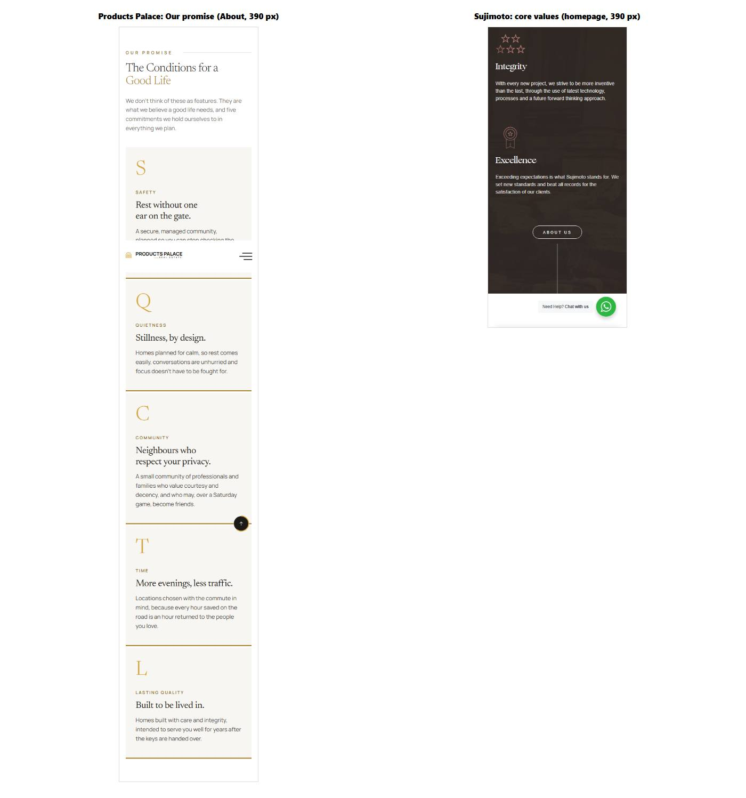
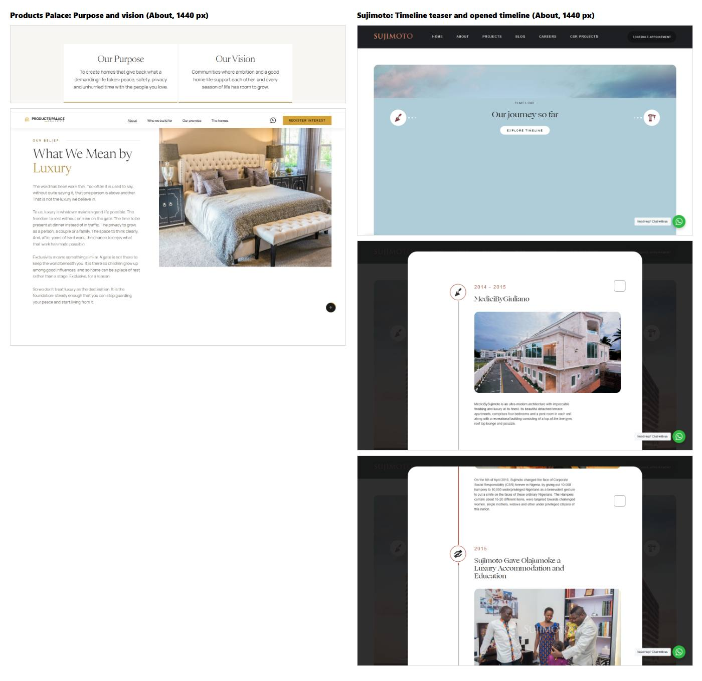

# Selective UI refinement: Sujimoto audit and recommendations

**Status: A, B and C approved (26 Nov 2026) and implemented; D not taken up.** The A sub-options
were not ticked, so the current pillars were kept and the film control is shown only once a film
exists (part of A's layout as proposed). Results are in
[§9](#9-implementation-outcome).

- **Primary foundation (unchanged):** Palton Morgan Holdings (`docs/homepage-reference-audit.md`,
  `docs/about-reference-audit.md`)
- **Secondary reference:** Sujimoto Group, https://sujimotonig.com/ and `/about-us/`. It already
  shapes the footer (`docs/footer-reference-audit.md`).
- **Content source of truth:** *Products Palace Brand Story* (PDF, Lagos 2026)
- **Audited:** 25–26 November 2026, with Playwright (Chromium) at 1440 × 900 and 390 × 844

## Contents

1. [Method and limitations](#1-method-and-limitations)
2. [Summary of recommendations](#2-summary-of-recommendations)
3. [Section classification](#3-section-classification)
4. [Homepage recommendations](#4-homepage-recommendations)
5. [About page recommendations](#5-about-page-recommendations)
6. [Approval checklist](#6-approval-checklist)
7. [Implementation plan (after approval)](#7-implementation-plan-after-approval)
8. [Appendix: Sujimoto measurements](#8-appendix-sujimoto-measurements)

---

## 1. Method and limitations

- **Products Palace:** the local build (`npm run dev`) and the live site,
  https://www.productspalace.com/. The live site serves the same build as `main`: the same
  headings and section order at both widths. Local captures therefore stand for both.
- **Sujimoto:** every section of the homepage and About page was captured at both widths. The
  timeline modal, the services slider, the core values and the "Redefining Luxury Living" band
  were also inspected individually. Geometry and styles come from `getBoundingClientRect` and
  `getComputedStyle`.
- **Comparison images** are in `docs/selective-ui-refinement/` (Products Palace on the left,
  Sujimoto on the right).
- **Copied:** nothing. Only layout, proportion and interaction patterns are described. No
  Sujimoto code, copy, colours, fonts, icons or images are proposed for use.

**Limitations**

- Chromium could not resolve `sujimotonig.com` with its own DNS. The host was mapped to the
  address the system resolver returned.
- The intro video overlay and the fixed background video were hidden before capture.
- The services slider's "next" arrow did not respond to automated clicks: a layer intercepts
  them. Its transition was inferred from markup (slick slider, four slides, image and text
  paired).
- Element captures of Products Palace sections sometimes show the sticky header across the top.
  This is an artefact of the capture method, not a layout bug.
- Tablet widths (768 and 1024) were not captured in this pass. The tablet behaviour proposed
  below comes from the existing breakpoints in the code (`md`, `lg`, `xl`).
- **Comparison images include screenshots of the Sujimoto site.** They are for internal review.
  Decide before any commit whether they belong in the repository; deleting them or adding them
  to `.gitignore` are both fine.

## 2. Summary of recommendations

The existing sections are, on the whole, stronger than their Sujimoto counterparts. In particular,
"Seasons of life" is already a richer version of Sujimoto's services slider. Sujimoto earns its
place in three specific spots:

| # | Page | Section | Classification | Sujimoto reference | Complexity |
| --- | --- | --- | --- | --- | --- |
| A | Home | Luxury, Redefined (`ExpertiseSection`) | **REPLACE LAYOUT** | Redefining Luxury Living | Medium |
| B | Home | Seasons of life (`ProjectShowcase`) | **REFINE** | Our Services | Small |
| C | About | Our promise (`OurPromise`) | **REPLACE LAYOUT** | Our Core Values | Medium |
| D | About | Purpose and vision (`OurPurpose`) → "How the idea took shape" | **OPTIONAL** (replace layout) | Our journey so far (timeline) | Medium |
| — | Home | New "arriving home" brand statement | **Not recommended** (see §4.3) | Quote band / Redefining Luxury Living | — |

This makes one major replacement on the homepage and one firm and one optional replacement on
the About page, within the limit of two per page.

**The idea that ties it together:** Sujimoto's strongest device is a single image-led statement:
full-bleed photography, a few oversized words and one short paragraph. It is used **once per
page**: in the homepage's belief section (A) and in the About page's promise band (C). Elsewhere
Sujimoto contributes motion details: parallax inside the image frame, and a hairline that
"threads" one section into the next. Both fit the Palton Morgan motion language already in the
site.

## 3. Section classification

### Homepage (`src/pages/HomePage.tsx`)

| # | Section (component) | Height 1440 / 390 | Class | Reason |
| --- | --- | --- | --- | --- |
| 1 | Hero (`Hero.tsx`) | 900 / 422 | KEEP | Strong Palton Morgan hero. Sujimoto's hero is a slider of featured projects, which Products Palace does not have yet |
| 2 | Our story (`AboutSection.tsx`) | 847 / 1164 | KEEP | Sujimoto's equivalent depends on statistics (35 projects, 400k m²). Products Palace has no figures, and inventing them is not allowed |
| 3 | Seasons of life (`ProjectShowcase.tsx`) | 1131 / 1561 | **REFINE** | See §4.1 |
| 4 | Luxury, Redefined (`ExpertiseSection.tsx`) | 1744 / 1929 | **REPLACE LAYOUT** | See §4.2 |
| 5 | Our promise (`ProcessSection.tsx`) | 968 / 834 | KEEP | Five photo cards already give the promises imagery. Sujimoto's three values would add nothing here |
| 6 | The moment we build for (`TestimonialsSection.tsx`) | 830 / 783 | KEEP | This is already the "arriving home" peak. See §4.3 |
| 7 | Our first address (`NewsSection.tsx`) | 1071 / 2236 | KEEP | There is no Sujimoto counterpart (its news and logo grids do not apply) |
| — | Footer (`SiteFooter.tsx`) | — | KEEP | Already adapted from Sujimoto |

### About page (`src/pages/AboutPage.tsx`)

| # | Section (component) | Height 1440 / 390 | Class | Reason |
| --- | --- | --- | --- | --- |
| 1 | Hero (`AboutHero.tsx`) | 676 / 416 | KEEP | Comparable to Sujimoto's banner, which is less refined |
| 2 | Our story (`OurStory.tsx`) | 780 / 1149 | KEEP | — |
| 3 | Our belief (`OurBelief.tsx`) | 1016 / 1242 | REFINE (minor, not Sujimoto-led) | The 600 px image ends about 160 px above the end of the four paragraphs, leaving a dead corner. Making the image column sticky, or stretching it to the text height, fixes this. Optional |
| 4 | Purpose and vision (`OurPurpose.tsx`) | 332 / 630 | **OPTIONAL** | See §5.2 |
| 5 | The lives we design around (`OurPeople.tsx`) | 1141 / 3089 | KEEP | The sticky cross-fading image is better than Sujimoto's team slider |
| 6 | Our promise (`OurPromise.tsx`) | 1062 / 2122 | **REPLACE LAYOUT** | See §5.1 |
| 7 | Our first address (`FirstAddress.tsx`) | 1251 / 2159 | KEEP | — |
| 8 | Closing (`AboutCTA.tsx`) | 593 / 624 | KEEP | — |

Sujimoto sections evaluated and **rejected**:

| Sujimoto section | Why not |
| --- | --- |
| Featured-project hero slider | No completed or launched projects to feature |
| CEO portrait and quote | No named founder or approved founder statement |
| Other businesses and Brand associations (logo grids) | No partners or subsidiaries. A grid would imply associations that do not exist |
| Team slider | No team profiles approved |
| Company overview (mission and vision as small dot-labelled columns) | Comparable to the current purpose cards. Kept as the fallback for §5.2 if the journey is declined |
| Newsletter band | Duplicates the register-interest form in the footer |
| Pill buttons, copper accent, painted textures | Brand identity: Products Palace keeps its square `btn-ink` and accent buttons, brass accent and photography |

---

## 4. Homepage recommendations

### 4.1 Seasons of life — REFINE (Candidate 1: Our Services)



| | |
| --- | --- |
| **Page / section** | Home, "Every Home Begins With a Person." (`ProjectShowcase.tsx`, `#people`) |
| **Sujimoto reference** | Homepage "Our Services": a portrait image (520 × 593) on the left, kicker with a full-width hairline, a 36 px title, two paragraphs and an outline pill on the right; arrow control; rotating circular text badge |
| **Current strengths** | Already the same composition (image left, story right) and richer: scene-setting moment label, display headline, the brand-story scene, "The home / What it makes possible" facts and a CTA. Autoplay pauses on hover, focus and hidden tabs; swipe works; `aria-roledescription="carousel"` is set; a slow zoom plays on the active image. On mobile the slider stays a slider. Sujimoto's text runs to about 10 lines per slide |
| **Current weaknesses** | (1) The pagination is four unlabelled dashes, so a visitor cannot see the four households at a glance. "Find your household" is the point of this section, yet three of the four are hidden at any time. (2) The image is static apart from the zoom, so the section has less depth than the clipped film and the scrubbed track around it |
| **Proposed improvement** | Keep the layout. (a) Replace the dash pagination with a **labelled household index**: four short tabs using the existing `person` values ("The one who is building", "The newlyweds", …), with a brass underline that fills over the 6 s autoplay interval to show the time left. (b) Add Sujimoto's **parallax inside the frame**: the image is drawn about 18 % taller than its frame and drifts up as the section scrolls (the measured drift is about 0.12 × scroll). This uses GSAP `scrub`, which already runs the site's other scroll effects |
| **Expected UX gain** | All four seasons are visible and directly choosable, so recognition ("that's me") no longer depends on waiting for autoplay. The extra depth makes the section match the motion of its neighbours |
| **Content** | None. The copy already follows the brand story's four households. The labels come from the existing `people.stories[].person` |
| **Responsive** | ≥ 1024: four tabs in one row beneath the card, arrows kept on the right. 768–1023: the tabs scroll horizontally (snap). < 768: back to the current dashes, with the active household named in the image chip (as now), because four tabs do not fit at 390 px |
| **Components / files** | `src/components/home/ProjectShowcase.tsx`. Possibly a progress keyframe in `src/styles/theme.css` (motion only; no colour or type tokens) |
| **Complexity** | Small |
| **Consistency risks** | Low. The tabs use existing kicker typography and the accent rule. The rotating badge is *not* adopted: the section already has the spinning sparkle |

### 4.2 Luxury, Redefined — REPLACE LAYOUT (Candidate 2: Luxury Living)




| | |
| --- | --- |
| **Page / section** | Home, "Luxury, Redefined." (`ExpertiseSection.tsx`, `#belief`) |
| **Sujimoto reference** | "Redefining Luxury Living": a full-bleed image band (1440 × 576) with an inner image 806 px tall that drifts with scroll. Three 70 px display words are staggered horizontally (offsets −140, +70 and −70 px). A short paragraph (≈ 252 px wide) sits beside the last word. On mobile: a 420 px band with the words stacked left-aligned |
| **Current strengths** | A dark band gives the page its one change of mood. The clip-open panel (Palton Morgan's signature) works well. The exclusivity statement is the brand's most distinctive paragraph. The pillars come straight from the brand story |
| **Current weaknesses** | (1) The largest element of the section (700 px tall at 1440) is a **film that does not exist**: the play button opens a placeholder notice. The poster is also reused as the About hero and the "family that has arrived" image. (2) The philosophy itself, "luxury is the foundation, not the destination", sits in a heading above the band, while the photograph carries no words, so image and idea never meet. (3) At 1,744 px (1,929 px on mobile) it is the longest section on the page. (4) The pillars (Security, Stillness, Time, Privacy) overlap the promise cards directly after them (Safety, Quiet, Time, Neighbours) |
| **Proposed layout** | One **image-led statement band** in place of the separate heading and film. The section reads top to bottom: <br>① **Statement band**: the existing clip-open panel (Palton Morgan motion kept), with the photograph drifting inside it (Sujimoto parallax). Inside the frame: the H2 set as two oversized, staggered lines, **"Luxury," / "Redefined."**, and the existing subtitle as a short paragraph beside the second line. A bottom gradient keeps text contrast ≥ 4.5 : 1. <br>② **Pillars**: the four-column row, unchanged in style, below the band. <br>③ **Exclusivity statement**: unchanged. <br>The play control appears only when a real film source exists (`expertiseFilm.src`). Until then the band is a still photograph, and `VideoLightbox` stays in the codebase untouched |
| **Wireframe (1440)** | ```[ dark band ─────────────────────────────────────────── ]``` <br> ```[ ┌ image, clip-opens, drifts ─────────────────────┐ ]``` <br> ```[ │      Luxury,                                    │ ]``` <br> ```[ │                Redefined.   Not the destination.│ ]``` <br> ```[ │                             The firm ground…    │ ]``` <br> ```[ └─────────────────────────────────────────────────┘ ]``` <br> ```[ ◆ Peace     ◆ Privacy     ◆ Time     ◆ Room to grow ]``` <br> ```[ On exclusivity — We don't close the gate… ]``` |
| **Expected UX gain** | The belief becomes a single memorable visual moment instead of a heading, a placeholder and a list. No dead-end click on a film that isn't there. About 250–300 px shorter on desktop and about 400 px on mobile |
| **Content adaptations** | Headline and subtitle: existing copy, no change. **Proposed (needs approval):** change the pillars so they cover the belief's broader promise (peace, privacy, time, relationships, family and growth) and stop repeating the promise cards: <br>• *Peace*: "The kind of security that lets a mother sleep through the night." (brand story) <br>• *Privacy*: existing copy <br>• *Time*: existing copy <br>• *Room to grow*: "The privacy to grow, as a person, a couple or a family." (already approved copy on the About page) <br>If declined, the four current pillars stay as they are |
| **Responsive** | ≥ 1200: band 640–700 px tall, staggered offsets as above. 768–1199: band about 520 px, offsets halved. < 768: band about 440 px, lines stacked left-aligned without offsets (as Sujimoto does on mobile), paragraph below the lines, pillars 2 × 2 then stacked (as now) |
| **Motion** | Clip-open scrub (existing), parallax drift (new, scrubbed), lines revealed one at a time with `data-reveal` (existing). All inside `gsap.matchMedia(MOTION_OK)`. With reduced motion everything is static |
| **Components / files** | `src/components/home/ExpertiseSection.tsx` (layout), `src/content/home.ts` (`belief`: split the title into lines; pillars only if the change is approved). `VideoLightbox.tsx` and `assets.ts` are unchanged |
| **Complexity** | Medium |
| **Consistency risks** | Oversized type over photography is new to the homepage. To stay on-brand it uses the existing display face and weights at the existing `type-display` scale, without Sujimoto's ultra-wide tracking. The photograph is a TEMP placeholder; the band will only look as good as the final photography |

### 4.3 Brand statement — NOT RECOMMENDED as a new section (Candidate 3)



- **Sujimoto reference:** two statement devices. A plain 192 px quote band (28 px accent serif,
  centred, no image) after the services, and the image-led "Redefining Luxury Living" near the
  bottom. The image-led one is the one Candidate 2 adopts.
- **Why not add one:** the homepage already ends on its emotional peak. "A Quarter Past Seven, on a
  Weekday Evening" *is* the feeling of arriving home, told in four beats from the brand story's
  prologue, and "That moment is the reason Products Palace exists." closes it. A further
  image-led "arriving home" band would:
  1. repeat the prologue a third time (hero line, moment beats, statement);
  2. use the image-statement device twice on one page, if A is approved, which is exactly the
     "two websites stitched together" effect to avoid;
  3. add about 600 px to a page that is already about 7,500 px long before the footer.
- **Classification:** "The moment" stays **KEEP**.
- **Fallback:** if A is *declined*, the device can move to the moment's closing line instead. The
  line "That moment is the reason Products Palace exists." would be set over a dusk or gate
  photograph, about 480 px tall, giving the statement band one home on the page either way.

---

## 5. About page recommendations

### 5.1 Our promise — REPLACE LAYOUT (Candidate 1: Core Values)




| | |
| --- | --- |
| **Page / section** | About, "The Conditions for a Good Life" (`OurPromise.tsx`, `#our-promise`) |
| **Sujimoto reference** | "Our Core Values" (homepage and About): a full-width dark band (≈ 760–800 px) over a heavily tinted photographic texture. Centred kicker and title, then three centred columns (387 px each, icon 84 × 60, serif title, short text) and an outline pill. A 1 px vertical hairline descends from the band's centre into the next section. On mobile the columns stack, left-aligned |
| **Current strengths** | Calm, honest copy written as commitments, not guarantees. Brass initials (S, Q, C, T, L) are a distinctive Products Palace device. The 3 + 2 centred grid handles five items without a gap |
| **Current weaknesses** | (1) The About page has **no image-led or dark moment** between the hero and the footer: every section is a light split or light cards, so the page loses momentum after "The lives we design around". (2) The five promises, the brand's most concrete commitments, are the least visually weighted section on the page: beige cards that look like the purpose cards above. (3) On mobile it is 2,122 px of five stacked cards. (4) The homepage already shows the promises as five photo cards, so the About page needs a *different* treatment, not the same one |
| **Proposed layout** | A **dark promise band with a single shared photograph**, adapted for five promises: <br>① A full-width ink band with one photograph under a deep ink tint (≈ 80–85 %), drifting slightly inside its frame. <br>② Centred kicker "Our promise", the H2 "The Conditions for a **Good Life**" (light tone, brass highlight kept) and the existing intro, centred, max 36 rem. <br>③ **Five columns at ≥ 1200 px** (about 236 px each inside the 1300 px container), divided by brass hairlines. Each column: the brass initial inside a 64 px hairline circle (Products Palace's initials replace Sujimoto's pictograms), the principle label, the headline in the display face, then the text, all centred. <br>④ Sujimoto's **vertical hairline**, drawn downward on scroll from the band's centre into "Our first address": a visual "first proof" thread. No pill button; the next section's CTA does that job |
| **Wireframe (1440)** | ```[ ink band, tinted photo ─────────────────────────────────────── ]``` <br> ```[                    OUR PROMISE                                    ]``` <br> ```[           The Conditions for a Good Life                          ]``` <br> ```[      We don't think of these as features. They are…               ]``` <br> ```[  (S)     │   (Q)     │   (C)     │   (T)     │   (L)              ]``` <br> ```[ SAFETY   │ QUIETNESS │ COMMUNITY │   TIME    │ LASTING QUALITY    ]``` <br> ```[ Rest without… │ Stillness… │ Neighbours… │ More evenings… │ Built… ]``` <br> ```[                          │  ← hairline into First address        ]``` |
| **Expected UX gain** | The About page gains one deliberate change of mood at the point where the visitor moves from imagination (the lives) to reassurance (the promises). All five commitments can be read side by side, and they gain weight without new claims. Mobile shortens from 2,122 px to about 1,600–1,700 px |
| **Content adaptations** | None. `ourPromise` in `src/content/about.ts` is used as it is |
| **Responsive** | ≥ 1200: five columns. 1024–1199: three plus two, centred (the current pattern). 768–1023: two per row, the fifth centred. < 768: one column, **left-aligned** (as Sujimoto does on mobile), with the initial circle on the left of the label and hairlines between items instead of cards. The hairline thread is hidden below 768 |
| **Motion** | Columns reveal with the existing `data-reveal="up"` and a 120 ms stagger. The hairline is drawn with a scrubbed `scaleY`, and the photograph drifts. Static with reduced motion |
| **Accessibility** | Light text on a tinted photograph: the tint is set so body text measures ≥ 4.5 : 1 everywhere on the image (checked by painting to canvas, as for earlier audits). The initials stay `aria-hidden`; the `h3` headlines are kept |
| **Components / files** | `src/components/about/OurPromise.tsx` (layout). `src/content/assets.ts`: one `aboutImages.promise` entry pointing to an **existing** placeholder photograph (no new downloads). No new tokens: it uses the existing ink, brass and line colours |
| **Complexity** | Medium |
| **Consistency risks** | Two dark sections in a row must be avoided. "Our first address" (light) follows, so the rhythm becomes light, light, grey band, **dark**, light, light, which works. The homepage's five photo cards and this single-backdrop band are deliberately different treatments of the same five promises |

### 5.2 Purpose and vision → "How the idea took shape" — OPTIONAL (Candidate 2: Our Journey)



| | |
| --- | --- |
| **Page / section** | About, "Our purpose and vision" (`OurPurpose.tsx`, `#our-purpose`) |
| **Sujimoto reference** | "Timeline: Our journey so far": a rounded image card (1300 × 760) with a centred "Explore timeline" button. It opens a **modal** (1008 px panel) with a vertical line, 70 px circular icon markers, and dated entries (year, title, image, paragraph). The line turns accent-coloured above the entry being read |
| **Current strengths** | Short and clear. The statements derive from the brand story |
| **Current weaknesses** | (1) It is the thinnest section on the page: two centred cards whose heading is hidden from sighted visitors, with **PROPOSED, unapproved wording**. (2) Nothing on the About page says plainly **where the company is now**: an idea, a belief and a pilot still being planned. Visitors piece that together from four separate sections |
| **Proposed layout** | Replace the two cards with an **inline** (not modal) vertical narrative of five stages, with **no dates**. Each stage: a 56 px hairline circle holding a numeral, a label, one line of copy, and a status for the last stage. The connecting line fills brass as the visitor scrolls past each stage (Sujimoto's progress line): <br>**01 · The question**: What does a home owe the person who works this hard? <br>**02 · The belief**: Luxury is the foundation, not the destination. <br>**03 · The purpose**: To create homes that give back what a demanding life takes. *(current proposed purpose)* <br>**04 · The vision**: Communities where ambition and a good home life support each other. *(current proposed vision)* <br>**05 · The first address**: *Being planned*. Location, homes and timeline will be shared once confirmed → "Who we build for" / "Find your place" <br>The line ends in a dashed segment after stage 05: the story is still being written |
| **Expected UX gain** | The page states its honest status in one glance: an idea becoming a first development. The proposed purpose and vision get context instead of floating as isolated cards |
| **Content adaptations** | New one-line summaries, all taken from the brand story or existing approved copy. **No dates, milestones, completed projects or achievements.** Purpose and vision remain PROPOSED wording and still need sign-off |
| **Responsive** | ≥ 1024: line centred, stages alternating left and right (two-sided timeline). < 1024: line on the left, all stages to its right. The fill animation stays; with reduced motion the line is drawn fully |
| **Components / files** | `src/components/about/OurPurpose.tsx` (rewritten in place; the file name is kept, as the project's naming convention requires), `src/content/about.ts` (`ourPurpose` gains `stages`) |
| **Complexity** | Medium |
| **Why optional** | Stages 01 and 02 summarise "Our story" and "Our belief", which sit directly above. Some visitors will read this as a recap rather than a repetition, others as repetition. If declined, a lighter fallback is Sujimoto's compact mission and vision presentation: two dot-labelled columns, no cards, placed under the "Our belief" heading. It removes one section without adding a timeline |

---

## 6. Approval checklist

Reply with the letters you approve (for example "A, B, C" or "A with current pillars, C"):

- [ ] **A**: Homepage "Luxury, Redefined": image-led statement band (§4.2)
  - [ ] A-content: change the pillars to Peace / Privacy / Time / Room to grow
  - [ ] A-film: hide the play control until a real film exists
- [ ] **B**: Homepage "Seasons of life": labelled household index and in-frame parallax (§4.1)
- [ ] **C**: About "Our promise": dark band with a shared backdrop, five columns, hairline thread (§5.1)
- [ ] **D**: About purpose → "How the idea took shape" (§5.2), *or* **D-fallback**: compact
  mission and vision
- [ ] Minor: About "Our belief", sticky image column (§3)
- [ ] Keep or remove the Sujimoto screenshots in `docs/selective-ui-refinement/` before any commit

## 7. Implementation plan (after approval)

Only approved items are built, in this order (the smallest risk first):

1. **B, Seasons refine:** household tabs with an autoplay progress rule, and the parallax drift.
   Keyboard: the tabs are buttons with `aria-current`, as the dashes are today.
2. **C, About promise band:** layout, tint and contrast check, column reveals and hairline scrub.
3. **A, Belief statement band:** reuse `ClippedFilm`'s clip-open scrub, add the drift and the
   staggered lines, and make the play control conditional.
4. **D, Journey** (if approved): stages from `about.ts`, scroll-filled line.

**Architecture rules followed:** page sections stay in `src/components/home/` and
`src/components/about/`; copy goes in `src/content/*.ts` and images in `src/content/assets.ts`; GSAP
helpers come from `src/lib/gsap.ts`; any motion keyframes go in `src/styles/theme.css` /
`motion.css`. No new colour, type or spacing tokens, no new dependencies, and no new shared
components unless two sections need the same piece. If they do, a small `ParallaxImage` in
`src/components/ui/` would serve A, B and C, rather than three copies.

**Validation (Phase 6):**

- Before and after captures at 1440, 1024, 768 and 390 px; side-by-side with the Sujimoto
  references.
- Confirm `theme.css` tokens and font families are unchanged (diff check).
- Horizontal overflow check (`scrollWidth === innerWidth`) at every width.
- Reduced-motion pass. Keyboard pass on the new tabs. Contrast on the image-led text.
- Anchors still resolve (`#people`, `#belief`, `#our-promise`, `#our-purpose`), including
  cross-page links from the About page and the footer.
- `npm run build` and `npm run lint` (the project has no test suite).
- Update `docs/design-system.md` (UI registry), `docs/homepage-content.md` /
  `docs/about-page-content.md` for any copy change, and this file with the outcome.
- **No commit or push without approval.**

## 8. Appendix: Sujimoto measurements

All measured at 1440 × 900 unless noted.

| Section | Observed |
| --- | --- |
| Our Services | Section 925 px. Grid of a 520 px image column and a 650 px text column inside a 1300 px container. Image frame 520 × 593, image 706 px tall, translated −108 to −124 px (parallax inside the frame). Kicker with a 1 px rule across the text column, title 36 px, two paragraphs, outline pill "Learn more", square arrow control at the right edge. A circular text badge rotates (7 s). Mobile: the slider is kept, with arrows over the image and the text below |
| Quote band | 192 px tall, `#f5f4f1`, one line, 28 px accent serif, centred (95 px tall on mobile) |
| Core values | 797 px (homepage) / 760 px (About). `#2f2723` with a tinted photographic texture. Kicker, then the title at 54 px line height, then three centred columns of 387 px with 84 × 60 icons. Outline pill, then a 1 px vertical line about 140 px long descending from the centre into the next section. Mobile: stacked, left-aligned |
| Redefining Luxury Living | 576 px full-bleed band. Image 806 px tall; its translate went from −152 to −116 px over a 300 px scroll (≈ 0.12 × scroll). Three lines, each 70 px / 70 px, offset −140, +70 and −70 px. Paragraph 12.6 px, about 252 px wide, beside the last line. Mobile: 420 px band, 42 px lines stacked left-aligned, paragraph below |
| Timeline | Teaser: a rounded image card 1300 × 760 with a centred kicker, title and pill, and circular icons at either end. Modal: a fixed overlay with a 1008 px white panel, a 2 px vertical line, 70 px circular markers, then year, title, a rounded image (630 × 350) and a paragraph per entry. The line is accent-coloured above the current entry and grey below |

## 9. Implementation outcome

Implemented: **A** (belief statement band), **B** (seasons refinement), **C** (About promise
band). Not implemented: D, the optional "Our belief" sticky image, the pillar rename.

### Files

| File | Change |
| --- | --- |
| `src/hooks/useParallax.ts` | **New.** Shared in-frame drift (`useParallax`, `PARALLAX_LAYER`), used by A, B and C |
| `src/components/home/ExpertiseSection.tsx` | A: statement band replaces the separate heading and film panel; pillars and exclusivity statement unchanged |
| `src/components/home/ProjectShowcase.tsx` | B: drifting image stack; named household tabs with a progress rule from 768 px; dashes kept on phones |
| `src/components/about/OurPromise.tsx` | C: dark band, five columns, scroll-drawn hairline |
| `src/content/home.ts` | `belief.title` split into its two lines (same words) |
| `src/content/assets.ts` | `aboutImages.promise` → existing placeholder `projects/project-03.jpg` |
| `src/styles/theme.css` | `--animate-progress-fill` keyframes only (no colour, type or spacing tokens) |
| Docs | `design-system.md`, `homepage-content.md`, `about-page-content.md`, `/asset-manifest.md` |

### Validation (production build, `vite preview`, Playwright Chromium)

| Check | Result |
| --- | --- |
| `npm run lint` | Pass, no warnings |
| `npm run build` | Pass (no test suite exists) |
| Horizontal overflow at 1440, 1024, 768 and 390 px, both pages | None (`scrollWidth === innerWidth`) |
| Console errors | None |
| Tokens | `theme.css` diff adds one motion keyframe; colours, fonts and spacing unchanged |
| Drift | Layer transform changes with scroll in all three sections; `none` with reduced motion |
| Reduced motion | Reveals, drift, clip-open and hairline static; the seasons rule shows full and still |
| Film control | Not rendered while `expertiseFilm.src` is undefined |
| Heading semantics | Belief H2 reads "Luxury, Redefined." (one heading, two visual lines) |
| Anchors | `#people`, `#belief`, `#our-promise` ids unchanged |
| Contrast over photography (98th-percentile background behind each text box) | Belief H2 ≥ 5.2 : 1 (large text, needs 3 : 1), belief subtitle ≥ 8.7 : 1; promise H2 ≥ 14.8 : 1, labels ≥ 7.8 : 1, body ≥ 8.5 : 1, intro ≥ 9.9 : 1 |

### Section heights (px, 1440 / 390)

| Section | Before | After |
| --- | --- | --- |
| Home: Luxury, Redefined | 1744 / 1929 | 1564 / 1766 |
| Home: Seasons of life | 1131 / 1561 | 1131–1225 / 1561 (varies with the active household's copy, as before) |
| About: Our promise | 1062 / 2122 | 925 / 1660 |

### Deviations and remaining limitations

- **Belief band composition:** Sujimoto staggers three words around the centre of the band. Here
  the two-line H2 sits bottom-left (second line indented 1.6 em), keeping the site's left-aligned
  heading convention and leaving the photograph's upper part clear.
- **About promise dividers:** brass hairlines between the columns appear only at ≥ 1200 px, where
  all five sit in one row; smaller layouts use spacing (tablet) or horizontal hairlines (phone).
- **Photography is TEMP.** The belief band reuses the film poster (also the About hero and a
  seasons image); the promise backdrop is a homepage promise-card photo. Final images matter more
  now that text sits on them; see `/asset-manifest.md`.
- **Tablet captures** (1024, 768) were checked after implementation, not in the original audit.
- **Not committed.** The Sujimoto screenshots in `docs/selective-ui-refinement/` still need a
  keep-or-remove decision before any commit.
